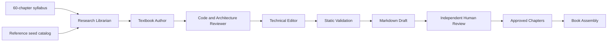

# Papyrus — CrewAI Technical Book Generator

Papyrus is a resumable multi-agent writing tool for **The Principal AI Engineer's Handbook**, a planned 60-chapter reference spanning mathematics, ML/DL, computer vision, GenAI, RAG, AWS Bedrock, agentic AI, MLOps, system design, product science, and leadership.

## Requirements
- Python 3.11–3.13
- An LLM provider API key (OpenAI by default)
- Optional: Pandoc for export, a LaTeX engine for PDF

## Installation

```bash
git clone https://github.com/Redcof/papyrus.git
cd papyrus
python3 -m venv .venv
source .venv/bin/activate
pip install -e '.[test]'
cp .env.example .env
```

Edit `.env` and replace `OPENAI_API_KEY` with your credential. **Never commit .env**.

## Run

```bash
bookgen draft --chapter 1 --dry-run
bookgen draft --chapter 1
bookgen draft --part 5
bookgen validate --chapter 1
bookgen approve --chapter 1 --reviewed
bookgen assemble
pytest -q
```

To select all chapters without generation, use `bookgen draft --all --dry-run`. To generate all 60, use `bookgen draft --all --confirm-cost` **only after estimating API costs**. Existing drafts are skipped unless `--force` is supplied.

## Architecture



Four CrewAI agents are implemented in `bookgen/crew.py`. The CLI in `bookgen/cli.py` manages resume/validation/approval/assembly.

## Project layout

```text
papyrus/
├── bookgen/
│   ├── __init__.py
│   ├── catalog.py
│   ├── crew.py
│   ├── quality.py
│   └── cli.py
├── tests/test_catalog.py
├── syllabus.json
├── references.json
├── pyproject.toml
├── .env.example
└── .gitignore
```

Generated content appears under `output/drafts/`, `output/approved/`, `output/reports/` and `output/books/`. These are excluded from git by default.

## Export

After `bookgen assemble`, an approved manuscript is available as `output/books/principal_ai_engineers_handbook.md`.

```bash
pandoc output/books/principal_ai_engineers_handbook.md -o output/books/principal_ai_engineers_handbook.docx
pandoc output/books/principal_ai_engineers_handbook.md -o output/books/principal_ai_engineers_handbook.pdf --pdf-engine=xelatex
```

PDF export requires a suitable LaTeX installation. Mermaid rendering may require separate preprocessing.

## Important quality limitations

The research agent receives a **seed reference catalog**, not retrieved source contents. References, mathematical claims, code examples, diagram rendering and cloud API details **must be independently verified** before publication.

The static checks validate basic structure, Python syntax and citation identifiers; they do not prove correctness or run model-generated code. `--reviewed` is a human assertion, not an automated proof.

## Security and cost

Never commit API keys. Draft generation may incur significant provider charges. Do not execute generated code without inspecting it in a sandbox. Use chapter-by-chapter review before a full book run.


## Autonomous research-to-publication workflow (v0.2)

Papyrus now offers a new `papyrus` CLI. Research metadata comes from Crossref and
OpenAlex; citations are validated against a per-chapter evidence bundle. **Bibliographic
metadata does NOT verify that a scholarly source supports a claim.** Keep human review.

```bash
papyrus research --chapter 1
papyrus pipeline --chapter 1
papyrus verify --chapter 1
papyrus approve --chapter 1 --reviewed
papyrus publish --format md
papyrus publish --format docx
papyrus publish --format pdf
```

The `--all` LLM generation command requires `--confirm-cost`. Use `--dry-run`
for an inexpensive syllabus overview. Generation is resumable unless `--force`.
Pandoc is required for DOCX, EPUB and PDF; PDF also requires a LaTeX engine.
Generated Python code is **parsed, not executed**; equations and claims require human checking.
`--render-mermaid` runs installed Mermaid CLI and is optional.
