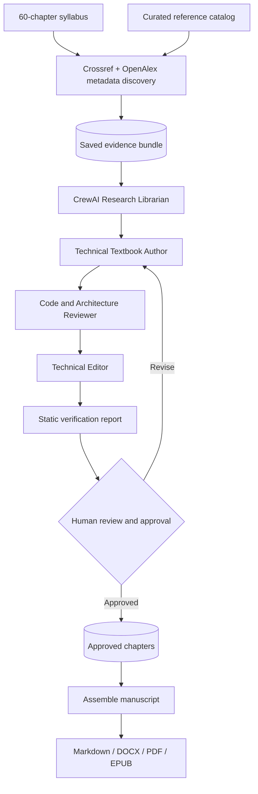

# Papyrus

**Autonomous research, writing, verification, and publishing for technical books**, powered by CrewAI.

Papyrus is an experimental, resumable Python pipeline designed to draft *The Principal AI Engineer's Handbook*: a **60-chapter** reference covering statistics, machine learning, deep learning, computer vision, generative AI, RAG, AWS Bedrock, agentic AI, MLOps, distributed systems, software engineering, product science, and Staff/Principal leadership.

> **Status: v0.2.0.** The research, drafting, verification, and publishing workflow is implemented. Full-text claim verification and sandboxed execution of generated examples are **not** implemented. A successful automated check does **not** establish factual or mathematical correctness.

## How it works



The **four CrewAI agents** live in `bookgen/crew.py`. CLI orchestration lives in `bookgen/autopilot.py`. Research metadata comes from Crossref and OpenAlex; chapter evidence is cached, so interrupted runs can resume without repeating completed work.

## Requirements

- Python **3.11–3.13**
- An LLM API key for the configured provider (OpenAI by default)
- Internet access to research metadata APIs for `research` / the research phase of `pipeline`
- Optional: [Pandoc](https://pandoc.org/) for DOCX, EPUB, and PDF exports
- Optional: a LaTeX engine such as XeLaTeX for PDF export
- Optional: Mermaid CLI (`mmdc`) for diagram rendering checks

## Installation

```bash
git clone https://github.com/Redcof/papyrus.git
cd papyrus

python3 -m venv .venv
source .venv/bin/activate
pip install -e '.[test]'

cp .env.example .env
```

Edit `.env` to set `OPENAI_API_KEY` and, if needed, `BOOK_LLM_MODEL` and `BOOK_TEMPERATURE`. You can optionally configure `OPENALEX_API_KEY`. **Never commit .env or secret keys.**

The installed distribution is named **`papyrus`**. The internal Python package remains `bookgen` for compatibility; both the current `papyrus` and legacy `bookgen` command-line entry points remain available.

## Quick start: research to publication

```bash
# Explore the syllabus, without LLM calls
papyrus pipeline --all --dry-run

# Retrieve and cache bibliographic metadata
papyrus research --chapter 1

# Research (if necessary), draft, and verify chapter 1
papyrus pipeline --chapter 1

# Inspect the report and re-run checks
papyrus verify --chapter 1

# Only after independently reviewing the draft
papyrus approve --chapter 1 --reviewed

# Assemble approved chapters into a Markdown manuscript
papyrus publish --format md

# Optional exports, if Pandoc is installed
papyrus publish --format docx
papyrus publish --format pdf
papyrus publish --format epub
```

### Additional commands

```bash
papyrus pipeline --part 5                 # RAG chapters
papyrus pipeline --chapter 1 --force      # Refresh research and regenerate
papyrus pipeline --all --confirm-cost     # Generate all 60 (API costs apply)
papyrus pipeline --part 5 --research-only # Research without LLM drafting
papyrus verify --chapter 1 --render-mermaid
papyrus publish --require-complete        # Fail unless all 60 are approved
python -m pytest -q
```

Existing evidence and drafts are reused unless `--force` is given. Avoid running the complete book generation until you have reviewed API usage, expected costs, and the quality of a representative chapter.

## What gets verified

| Check | Behavior | Limitation |
| --- | --- | --- |
| Research | Crossref DOI metadata, OpenAlex discovery | Metadata and abstracts do **not** prove claim-level support |
| Citations | Ensures in-text citation IDs exist in the evidence bundle | Does not establish factual relevance or source correctness |
| Python examples | Parses fenced Python blocks with Python's AST | Does not run or test generated code |
| Diagrams | Detects Mermaid blocks; optionally invokes `mmdc` | Diagram correctness still needs human inspection |
| Structure | Required chapter sections and mathematical display checks | Cannot prove equations or arguments are mathematically correct |
| Publishing | Includes only approved chapters by default | Human review must be substantive, not a rubber stamp |

`papyrus approve --reviewed` records the operator's assertion that the chapter was independently reviewed. Treat all model-generated material as untrusted until reviewed. Never execute generated code without inspection and isolation.

## Project layout

```text
papyrus/
├── bookgen/
│   ├── __init__.py
│   ├── autopilot.py       # v0.2 CLI: research, pipeline, verify, approve, publish
│   ├── catalog.py         # syllabus and reference catalog
│   ├── cli.py             # legacy bookgen CLI
│   ├── crew.py            # four CrewAI agents
│   ├── pipeline.py        # resumable chapter orchestration
│   ├── publishing.py      # approved-only assembly and Pandoc exports
│   ├── quality.py         # Markdown structure and code syntax checks
│   ├── research.py        # Crossref/OpenAlex metadata collection
│   └── verification.py    # citation, syntax, diagram verification
├── tests/
│   ├── test_catalog.py
│   └── test_pipeline.py
├── .github/workflows/tests.yml
├── syllabus.json
├── references.json
├── .env.example
└── pyproject.toml
```

Generated files are written under `output/`:

- `research/` — evidence bundles, one per chapter
- `drafts/` — generated chapter drafts
- `reports/` — automated verification reports
- `approved/` — manually approved chapters
- `books/` — assembled manuscript, export files, and build manifest

These output directories are ignored by Git by default.

## Publishing

The Markdown manuscript is assembled at `output/books/principal_ai_engineers_handbook.md`. You can export it through the CLI, or manually:

```bash
pandoc output/books/principal_ai_engineers_handbook.md -o output/books/principal_ai_engineers_handbook.docx
pandoc output/books/principal_ai_engineers_handbook.md -o output/books/principal_ai_engineers_handbook.pdf --pdf-engine=xelatex
```

Mermaid diagrams may need preprocessing before they appear as rendered images in exported documents.

## Security, reliability, and cost

- Keep credentials out of source control.
- Review individual chapters before scaling up expensive LLM generation.
- Bibliographic discovery is not full-paper retrieval or independent fact checking.
- Generated formulas, API usage, and references require careful review.
- Do not execute generated code on a host machine without sandboxing.
- The GitHub Actions workflow runs offline unit tests, not LLM generation.

## Roadmap

- Licensed full-text retrieval and citation-to-claim grounding
- Isolated execution and unit tests for generated Python examples
- Mathematical verification for selected derivations and numerical claims
- Automated illustration/diagram rendering and improved book layout
- Evidence provenance, editorial review history, and publication release automation

This repository is intended as a practical foundation for a technical-book production workflow, not a substitute for scientific or editorial review.
